# Liner

**An e-ink frame that hangs one track at a time from [320kbps.club](https://www.320kbps.club), like a work in a museum.**
A [LesWWW](https://leswww.com) project · **[liner.leswww.com](https://liner.leswww.com)**

The cover and its liner notes sit on a museum label, laid over a map of where the artist comes from.
A new track every morning and evening, and a small web page to change it from your phone.

<p>
  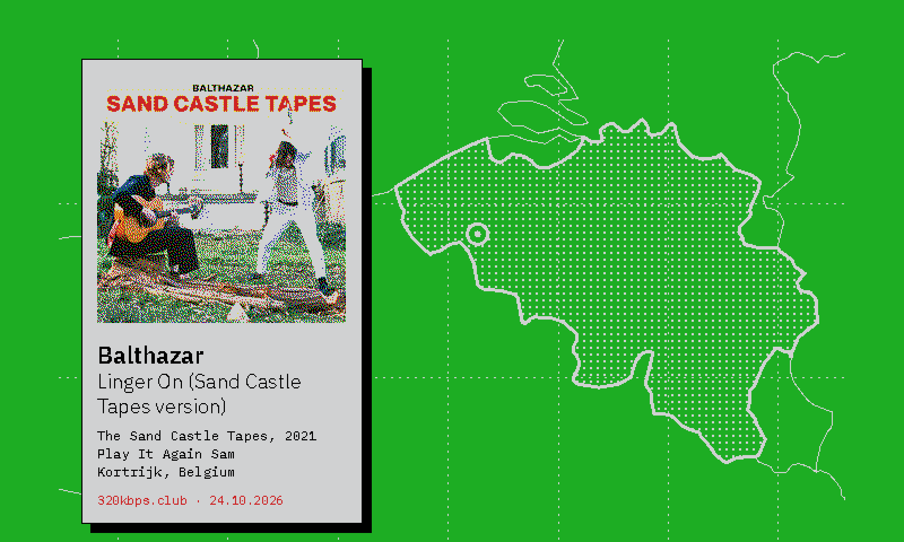
  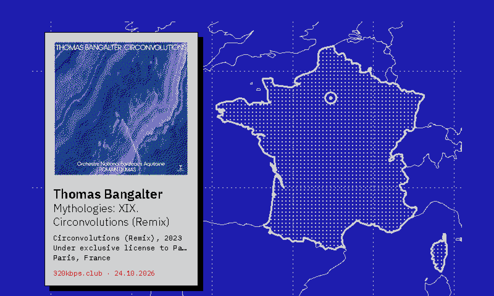
  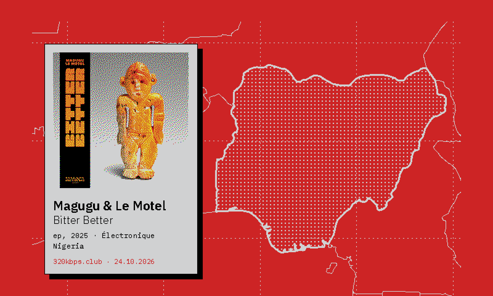
  
</p>

## Gallery

Fifteen tracks as Liner drew them. Click one to listen on 320kbps.club; every picture, with its 4K wallpaper and
black and white versions, is on [liner.leswww.com/gallery](https://liner.leswww.com/gallery).

<table>
<tr><td width="33%"><a href="https://www.320kbps.club/track/thomas-bangalter-mythologies-xix-circonvolutions-remix"></a><br><sub><a href="https://www.320kbps.club/track/thomas-bangalter-mythologies-xix-circonvolutions-remix">Thomas Bangalter — Mythologies: XIX. Circonvolutions (Remix)</a></sub></td><td width="33%"><a href="https://www.320kbps.club/track/balthazar-linger-on-sand-castle-tapes-version"></a><br><sub><a href="https://www.320kbps.club/track/balthazar-linger-on-sand-castle-tapes-version">Balthazar — Linger On (Sand Castle Tapes version)</a></sub></td><td width="33%"><a href="https://www.320kbps.club/album/magugu-le-motel-bitter-better-ep"></a><br><sub><a href="https://www.320kbps.club/album/magugu-le-motel-bitter-better-ep">Magugu & Le Motel — Bitter Better - EP</a></sub></td></tr>
<tr><td width="33%"><a href="https://www.320kbps.club/album/nine-inch-nails-still">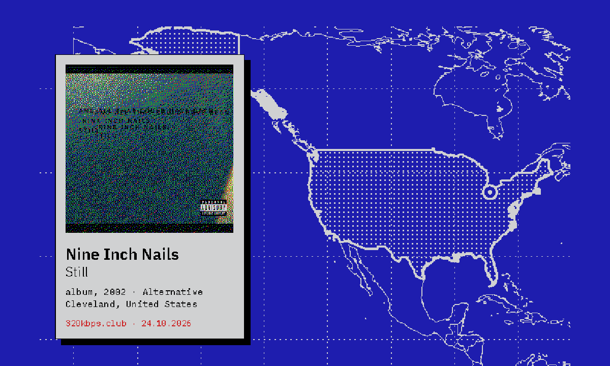</a><br><sub><a href="https://www.320kbps.club/album/nine-inch-nails-still">Nine Inch Nails — Still</a></sub></td><td width="33%"><a href="https://www.320kbps.club/track/agnes-obel-tangerine">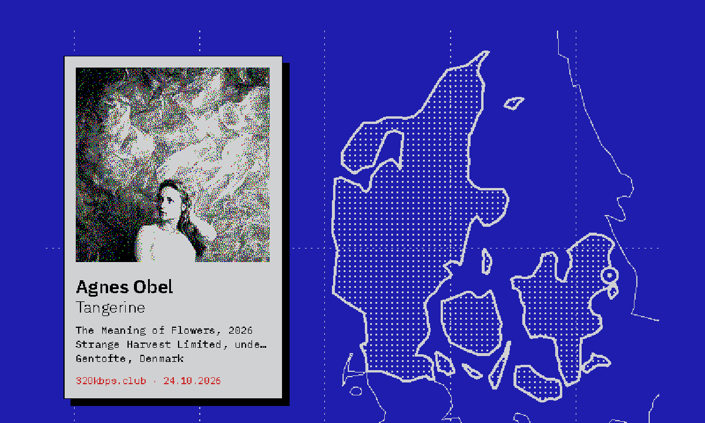</a><br><sub><a href="https://www.320kbps.club/track/agnes-obel-tangerine">Agnes Obel — Tangerine</a></sub></td><td width="33%"><a href="https://www.320kbps.club/track/the-bamboos-hard-up">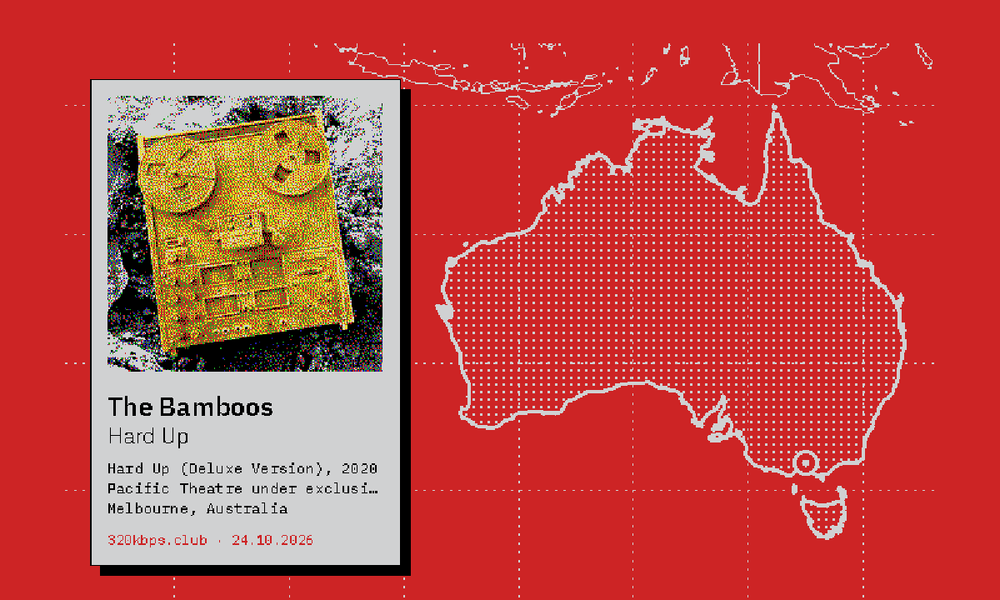</a><br><sub><a href="https://www.320kbps.club/track/the-bamboos-hard-up">The Bamboos — Hard Up</a></sub></td></tr>
<tr><td width="33%"><a href="https://www.320kbps.club/album/austin-tv-ma">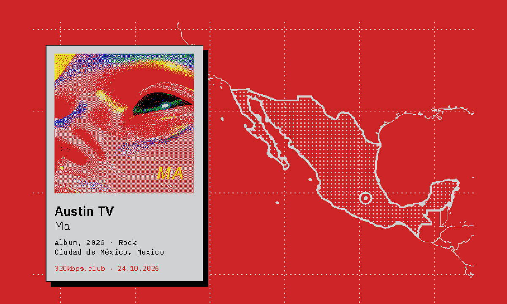</a><br><sub><a href="https://www.320kbps.club/album/austin-tv-ma">Austin TV — Ma</a></sub></td><td width="33%"><a href="https://www.320kbps.club/track/deluxe-saxophone-concerto-e-minor-op-88">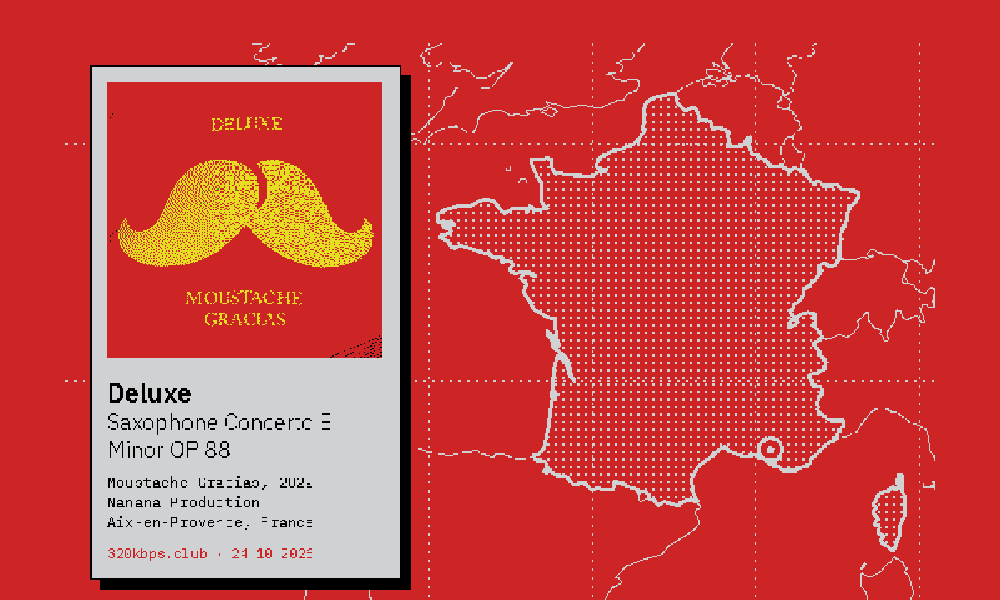</a><br><sub><a href="https://www.320kbps.club/track/deluxe-saxophone-concerto-e-minor-op-88">Deluxe — Saxophone Concerto E Minor OP 88</a></sub></td><td width="33%"><a href="https://www.320kbps.club/track/the-verve-bitter-sweet-symphony-james-lavelle-remix">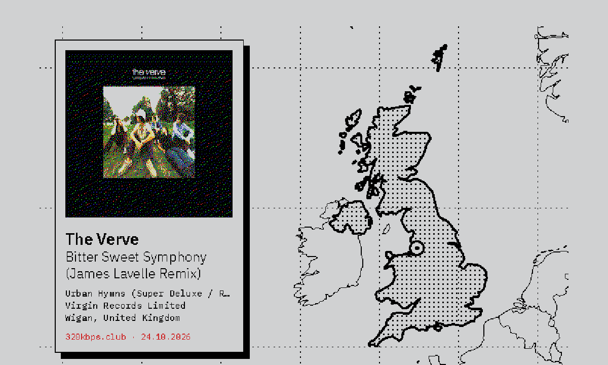</a><br><sub><a href="https://www.320kbps.club/track/the-verve-bitter-sweet-symphony-james-lavelle-remix">The Verve — Bitter Sweet Symphony (James Lavelle Remix)</a></sub></td></tr>
<tr><td width="33%"><a href="https://www.320kbps.club/track/manchester-orchestra-i-know-how-to-speak-acoustic-version">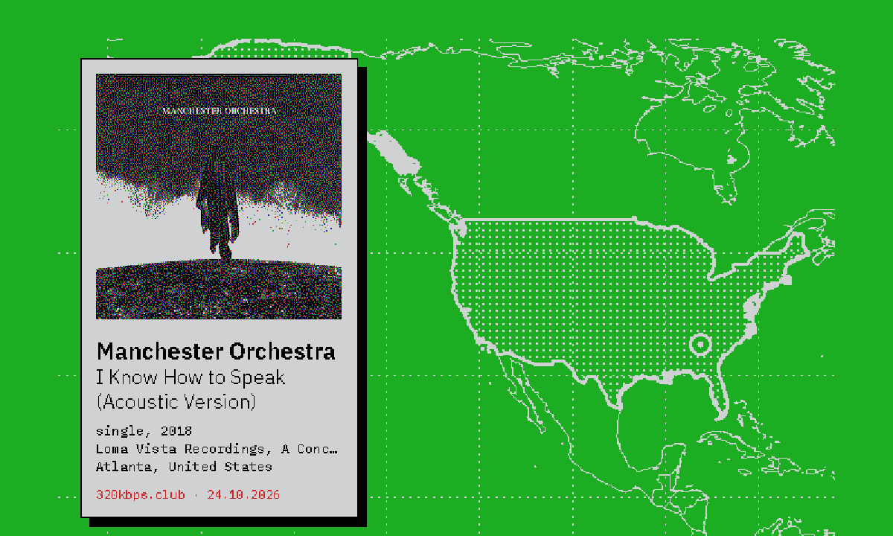</a><br><sub><a href="https://www.320kbps.club/track/manchester-orchestra-i-know-how-to-speak-acoustic-version">Manchester Orchestra — I Know How to Speak (Acoustic Version)</a></sub></td><td width="33%"><a href="https://www.320kbps.club/track/cheese-people-wake-up">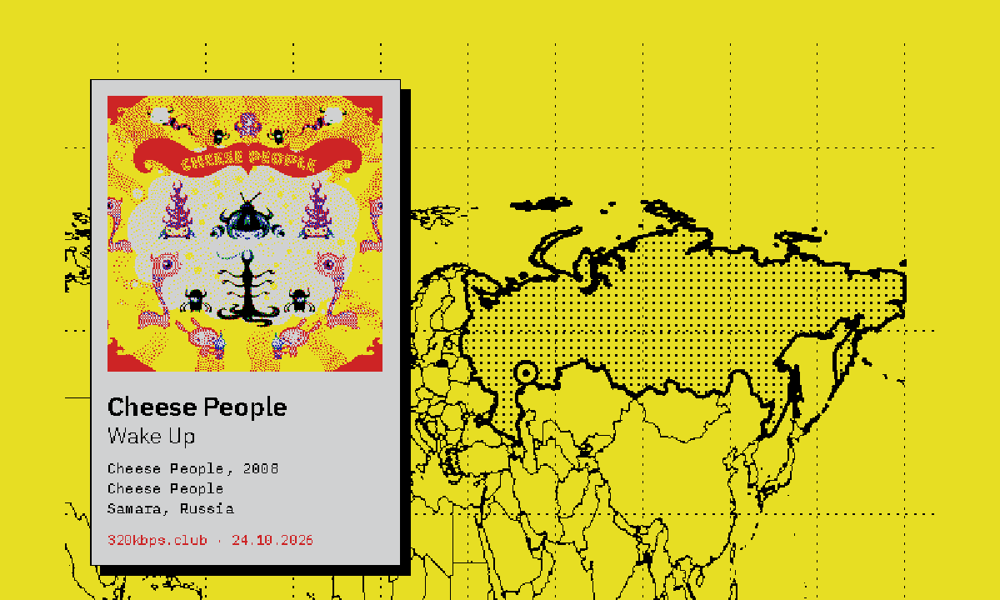</a><br><sub><a href="https://www.320kbps.club/track/cheese-people-wake-up">Cheese People — Wake Up</a></sub></td><td width="33%"><a href="https://www.320kbps.club/track/dave-grohl-joshua-homme-trent-reznor-mantra">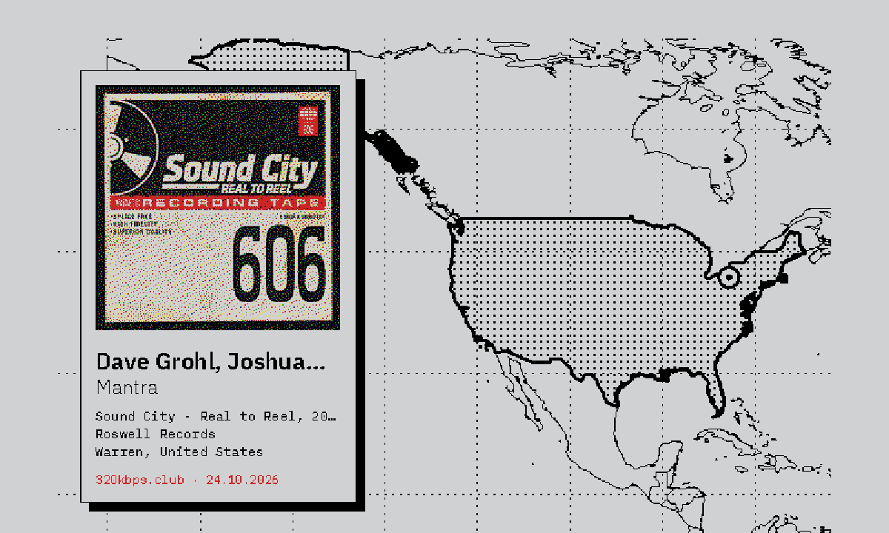</a><br><sub><a href="https://www.320kbps.club/track/dave-grohl-joshua-homme-trent-reznor-mantra">Dave Grohl, Joshua Homme & Trent Reznor — Mantra</a></sub></td></tr>
<tr><td width="33%"><a href="https://www.320kbps.club/track/omar-rodriguez-lopez-through-a-glass-darkly">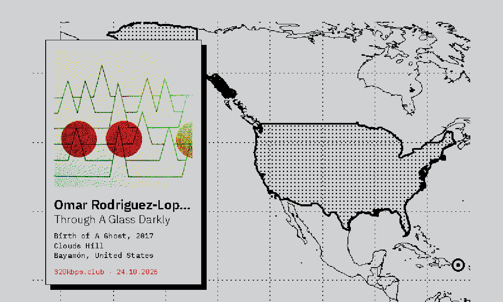</a><br><sub><a href="https://www.320kbps.club/track/omar-rodriguez-lopez-through-a-glass-darkly">Omar Rodriguez-Lopez — Through A Glass Darkly</a></sub></td><td width="33%"><a href="https://www.320kbps.club/track/synapson-bonga-mona-ki-ngi-xica">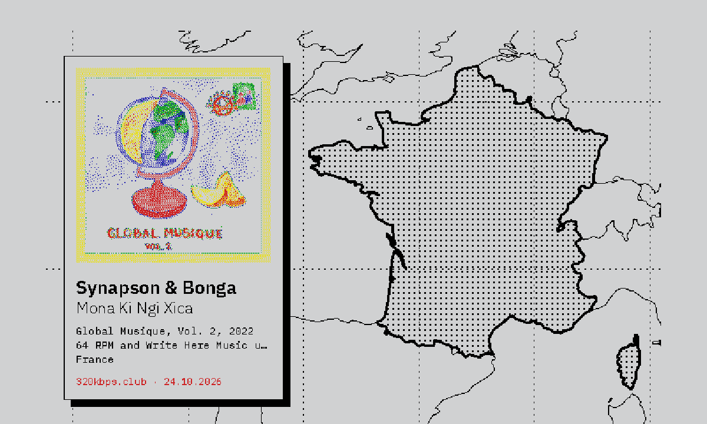</a><br><sub><a href="https://www.320kbps.club/track/synapson-bonga-mona-ki-ngi-xica">Synapson & Bonga — Mona Ki Ngi Xica</a></sub></td><td width="33%"><a href="https://www.320kbps.club/track/degiheugi-la-fine-equipe-favelas-la-fine-equipe-remix">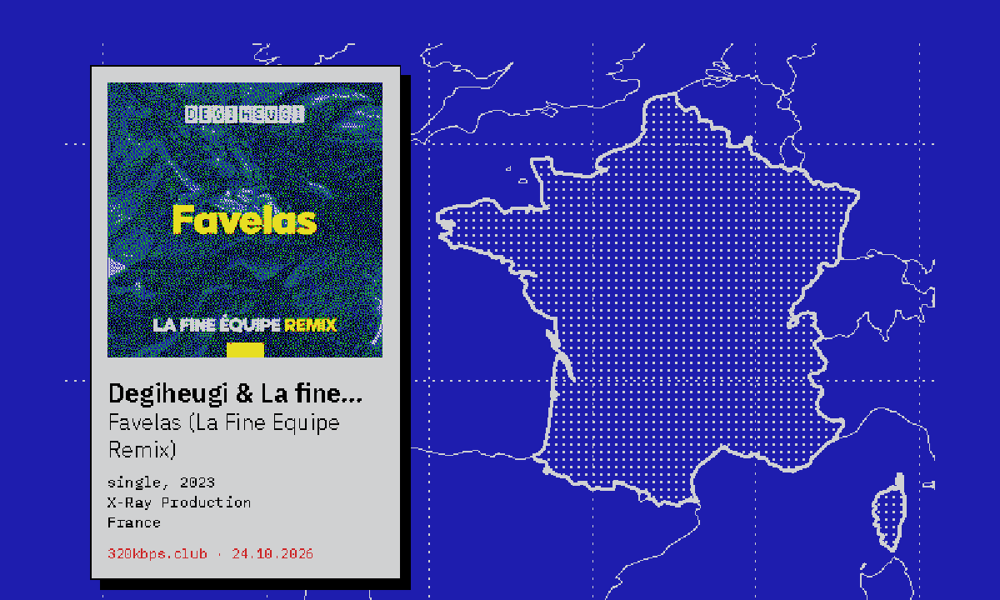</a><br><sub><a href="https://www.320kbps.club/track/degiheugi-la-fine-equipe-favelas-la-fine-equipe-remix">Degiheugi & La fine équipe — Favelas (La Fine Equipe Remix)</a></sub></td></tr>
</table>

## What is on the wall

- **A duotone map** of the artist's home country, with its neighbours and a dotted graticule; a ring marks the city
  when there is one. The duotone comes from the cover's dominant ink: blue and white, red and white, green and white,
  yellow and black, or black and white when the cover has no strong colour.
- **A museum label** on top: the cover, dithered onto the panel's six inks, then artist, title, album, year, label
  and origin.
- **Where the artist comes from**, not where they live: Thomas Bangalter is from Paris, even if the feed says
  Beverly Hills (see [Origins](#origins)).

## Hardware

| | |
|---|---|
| Computer | Raspberry Pi Zero 2 W, Raspberry Pi OS Bookworm (Lite is enough) |
| Screen | [Pimoroni Inky Impression 7.3"](https://shop.pimoroni.com/products/inky-impression-7-3) **Spectra 6** (800 × 480; black, white, yellow, red, blue, green) |
| Frame | Any photo frame with a mat. The mat hides the edges of the panel, so the layout stays inside the [visible area](#visible-area) |

Two panels are sold as "Inky Impression 7.3"": this code targets the 2025 Spectra 6 (no orange ink).

## How it works

```
   phone                    Vercel                        Raspberry Pi
 ┌───────────┐ request ┌────────────────┐  GET /api/pi   ┌──────────────────┐
 │ web page  │ ──────► │ command.json   │ ◄───────────── │ liner.py --sync  │  every minute, 7:00–midnight
 └─────┬─────┘         │ (Vercel Blob)  │                └────────┬─────────┘
       │ ◄──────────── │ status.json    │ ◄── POST ───────────────┤ after each redraw,
       │  picture, PNG │ pictures/*.png │ ◄── PUT  ───────────────┤ with the picture
       │               └───────┬────────┘                         │
       │                       │ GET /api/map  ◄──────────────────┤ map of the artist's origin
       │                       ▼                         ┌────────┴─────────┐
       │                 MusicBrainz, Nominatim          │ liner.py         │  7:00 and 19:00
       │                 Natural Earth outlines          └──────────────────┘
```

- The Pi sits behind a home router, so Vercel cannot reach it: **the Pi polls** the page every minute. A request
  takes up to a minute to be picked up, then about 30 seconds of e-ink redraw. The page follows along and flashes
  when the frame is done.
- **The Pi draws the layout** (Python, Pillow). **Vercel draws the map** (`/api/map`, SVG rasterised by sharp, cached
  by the CDN for good), so outlines, geocoding and MusicBrainz stay off the Pi Zero.
- Every redraw yields **three pictures**, all uploaded and downloadable from the control room: what the colour
  panel shows (PNG), the same for a black and white panel (1-bit PNG), and a **4K wallpaper** (3840 × 2160 JPEG,
  same layout drawn smooth: full-definition cover, vector map in the panel's tones). The Pi draws the e-ink one
  first and makes the other two once the frame is up to date.
- Without the web page (no `liner.env`), the frame still runs on its own, twice a day, without maps.

## Repository

```
app/                  web (Next.js), in the LesWWW charter
  page.tsx            public landing page
  control/            control room, behind a password
  NowPlaying.tsx      request tracking, flash when the frame is done
  Frame.tsx           the frame mockup (wood, mat, visible area)
  api/pi/             the frame: poll for requests, report a redraw, upload its picture
  api/map/            duotone map of an artist's origin, as a PNG in the panel's inks
  api/status/         polled by the page while a request is on its way
lib/
  feed.ts             320kbps.club RSS feed
  map.ts              origin lookup (MusicBrainz, Nominatim) and map drawing
  store.ts            requests, status and pictures in Vercel Blob
  frame.ts            panel size and visible area, shared with the mockup
  countries.json      country outlines (Natural Earth 1:50m, simplified)
pi/
  liner.py            the frame: data, layout, display, sync
  fonts/              IBM Plex Sans (variable) and IBM Plex Mono
  systemd/            liner.timer (7:00, 19:00) and liner-sync.timer (every minute)
  install.sh          installs dependencies and services
public/               avatar, Open Graph image, sample pictures for the landing page
docs/                 sample pictures
```

## Set up the frame

The full guide, from parts to calibration, is in **[docs/BUILD.md](docs/BUILD.md)**. In short:

```sh
git clone https://github.com/kxrz/leswww-liner.git ~/liner
cd ~/liner/pi
cp liner.env.example liner.env   # then fill in LINER_TOKEN
./install.sh
```

Enable SPI and I2C first (`sudo raspi-config` › Interface Options). Update with
`cd ~/liner && git pull && pi/install.sh`.

| | |
|---|---|
| Next track now | `sudo systemctl start liner` |
| What happened | `journalctl -u liner -u liner-sync -n 30` |
| Next runs | `systemctl list-timers 'liner*'` |
| Try a layout without touching the screen | `python3 liner.py --preview`, then open `preview.png` |
| Fill the gallery with the newest tracks | `python3 liner.py --seed 15` (screen untouched) |
| Show the calibration grid | `python3 calibrate.py` |

`state.json` remembers the tracks already shown and the last request handled; delete it to start again from the
newest track.

## Deploy the web page

The Vercel project (`leswww-liner`, served at [liner.leswww.com](https://liner.leswww.com)) is linked to this repository: every push to `main` deploys. Connect a Blob store, then set:

| Variable | |
|---|---|
| `BLOB_READ_WRITE_TOKEN` | Set by Vercel when the Blob store is connected |
| `SITE_PASSWORD` | Password for the page. Without it, the page is open to anyone |
| `DEVICE_TOKEN` | The frame's token, same as `LINER_TOKEN` in `pi/liner.env`. Without it, `/api/pi` and `/api/map` are open |
| `NEXT_PUBLIC_LINER_VISIBLE` | Your frame's visible area for the mockup, as in `LINER_VISIBLE` (default `52,35,748,480`) |
| `RESEND_API_KEY`, `ALERT_EMAIL`, `ALERT_FROM` | Optional: a daily email when the frame has been silent for two hours |
| `CRON_SECRET` | Optional: lets only Vercel's cron call the health check |

On a phone, "Add to Home Screen" turns the page into a small app. Locally: `npm install && npm run dev`, with a
`.env.local` (see `.env.example`).

## Design notes

### Inks

- **Text is never antialiased** (`fontmode = "1"`). Grey edge pixels would snap to the nearest ink, often blue,
  and every letter would get a coloured fringe.
- **Only the cover is dithered** (Floyd-Steinberg), towards the colours the panel *actually* shows: the 50/50 blend
  of the Pimoroni driver's `SATURATED_PALETTE` and `DESATURATED_PALETTE`, as `set_image()` does by default. The
  final image goes to the driver as a six-colour palette image, so it does not dither again.
- **The map** is an SVG drawn with `shape-rendering="crispEdges"` in pure inks, mapped back to the palette without
  dithering on the Pi.
- **Previews and downloads** use the ink colours, so their greyish white is the panel's real white.

### Web

- `/control` (password) shows the frame and its health (online, silent or asleep; temperature, uptime, code
  version), sends requests, picks the **feed to follow** (any RSS feed; every 320kbps.club curator and playlist is
  suggested), and offers the three downloads for each track.
- `/gallery` lists what has hung on the wall: click a picture to hang it in the frame mockup, download the 4K
  wallpaper, or listen on 320kbps.club.
- `/` is the public landing page: today's picture in a frame mockup, a before/after slider (HD vs e-ink), the black
  and white version, how it works, hardware, credits. It is rebuilt at most every ten minutes.
- SEO and GEO: canonical URL, Open Graph image, a JSON-LD graph (page, creative work, source code, Florent
  Bertiaux, LesWWW, 320kbps.club), `robots.txt`, `sitemap.xml` and [`llms.txt`](public/llms.txt).
- Vercel Analytics (cookieless). Legal notice, privacy policy and terms are those of
  [leswww.com](https://www.leswww.com/mentions-legales).
- Styled after the LesWWW charter: Big Shoulders, Public Sans and IBM Plex Mono, black and white, lemon for
  interactive things only, cyan for verified data.

### Origins

The 320kbps.club feed gives the place an artist is *based* (MusicBrainz "area"). Liner looks for where they were
*born or formed* ("begin-area"):

1. Search MusicBrainz for the exact artist name; the feed's origin picks between namesakes
   (Deluxe from Aix-en-Provence, not Samy Deluxe from Hamburg).
2. Use the begin-area when it is a city, or the country when it is one (Magugu, born in Nigeria, based in the UK).
   A region ("England") falls back to the country.
3. A collaboration ("A & B") resolves to the first artist found.
4. Failing that, the feed's origin; failing that, a plain background.

### Visible area

The mat hides part of the panel. Measured with a test grid: x 52 → 748, y 35 → 480. Everything is laid out inside
`VISIBLE` (top of `pi/liner.py`, mirrored in `lib/frame.ts` for the mockup). If the Pi moves in its frame, that is
the only value to change.

## Credits

Liner is designed and built by [LesWWW](https://leswww.com), the studio behind [320kbps.club](https://www.320kbps.club).

- Music: [320kbps.club](https://www.320kbps.club) feed and album pages
- Outlines: [Natural Earth](https://www.naturalearthdata.com) 1:50m, public domain
- Origins: [MusicBrainz](https://musicbrainz.org) (CC0); cities: [Nominatim](https://nominatim.openstreetmap.org), © OpenStreetMap contributors
- Fonts: [IBM Plex](https://github.com/IBM/plex) on the frame; Big Shoulders, Public Sans and IBM Plex Mono on the web, per the LesWWW charter (SIL Open Font License)

## License

[MIT](LICENSE) © LesWWW
